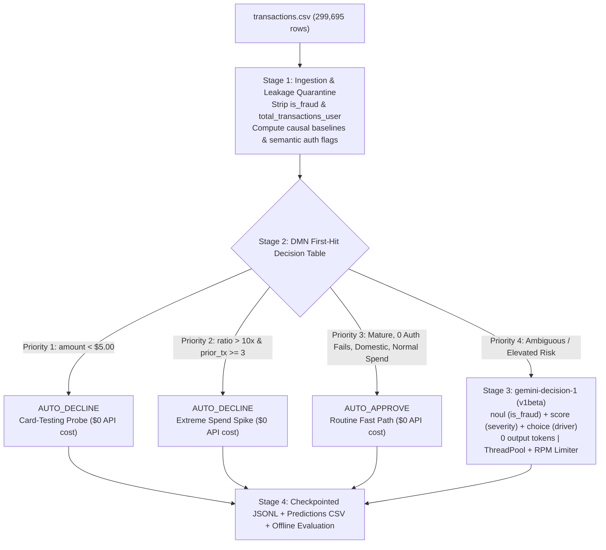

# Fraud Detection Decision Model

A hybrid fraud detection decision system combining a declarative **DMN-style First-Hit rule engine** with Google's **`gemini-decision-1`** Decisions API (`google-genai >= 3.2.0`, `v1beta`) to classify e-commerce transactions with calibrated probabilities, severity scores, structured risk drivers, and **zero output-token overhead**.

---

## Architecture



---

## Key Dataset & Leakage Engineering Findings

Forensic analysis of `transactions.csv` (`299,695` rows, `6,000` users, `2.21%` fraud prevalence) uncovered critical leakage and synthetic-artifact traps addressed in [src/fraud_decision_model/preprocess.py](src/fraud_decision_model/preprocess.py):

- **`is_fraud` & `total_transactions_user` Quarantined:** `total_transactions_user` is constant per user across the entire 10-month horizon and equals the exact future transaction count (`6,000 / 6,000` users). Both are stripped on ingestion.
- **Strictly Causal Spend Baseline (`production_strict` default):** The CSV's `avg_amount_user` is static and correlates `0.996` with each user's legitimate-only mean across all months. In `production_strict` mode, the pipeline replaces it with a strictly causal expanding prior average per `user_id` (plus causal chronological global median fallback on transaction #1). Pass `--feature-mode dataset_benchmark` to compare against the provided static baseline.
- **User-Grouped Stratified Pilot Sampling:** Fraud is strongly bimodal across accounts (`126` accounts with `account_age_days <= 90` carry `17–31` frauds each, ~47% of total fraud). Pilot sampling draws disjoint `user_id` pools across fraud and legitimate strata to avoid single-user clustering leakage.
- **Synthetic Distance Artifact Avoided in DMN Rules:** `shipping_distance_km` is synthetically scaled in the dataset (`1.5x` on fraud rows). Rather than hard-coding brittle distance cliffs into deterministic auto-declines, the DMN table only uses domain-grounded card-testing (`< $5`), spend-spike (`> 10x` with history), and clean domestic fast-approve boundaries, escalating long-distance/ambiguous transactions to `gemini-decision-1`.

---

## How `gemini-decision-1` Is Used

For every escalated transaction, [src/fraud_decision_model/decision_client.py](src/fraud_decision_model/decision_client.py) sends a sanitized JSON payload (`transaction_id`, `user_id`, and `is_fraud` stripped) alongside three closed-ended questions defined in [config/decision_questions.yaml](config/decision_questions.yaml) in a single `client.decisions.create(...)` call:

1. **`is_fraud` (`type: noul`):** Returns calibrated fraud probability `P(fraud)` and model confidence.
2. **`risk_severity` (`type: score`):** Grades transaction across a 5-level ordered rubric (`0.0` Benign Routine to `4.0` Critical Fraud).
3. **`primary_risk_driver` (`type: choice`):** Classifies the dominant risk mechanism (`legitimate_routine`, `card_testing_micro_amount`, `spend_spike_anomaly`, `auth_failure_takeover`, `cross_border_mismatch`, `new_account_high_risk`, `promo_or_channel_abuse`) to generate deterministic, auditable `reasoning` with **0 output tokens**.

---

## Setup

### 1. Install Dependencies

```bash
python -m pip install -r requirements.txt
```

Optional editable install (or run directly from the repo root — scripts configure `src/` automatically):

```bash
python -m pip install --no-build-isolation --no-deps -e .
```

### 2. Configure API Key

Copy `.env.example` to `.env` and insert your Gemini API key:

```bash
cp .env.example .env
```

```dotenv
GEMINI_API_KEY=your_gemini_api_key_here
GEMINI_USE_VERTEXAI=false
GEMINI_DECISION_MODEL=gemini-decision-1
```

> Never commit `.env` or raw `transactions.csv` (both are listed in `.gitignore`).

---

## How to Run

### 1. Run Unit Tests (Offline)

```bash
python -m unittest discover -s tests -v
```

### 2. Run Quick Verification & Dry-Run Funnel (`test.py`)

Run unit tests + dataset preprocessing + DMN routing dry-run without calling the API:

```bash
python test.py --offline
```

Run the full check including the **live 5-row `gemini-decision-1` smoke test**:

```bash
python test.py
```

### 3. Dry-Run the CLI Pipeline (Cost & DMN Routing Estimate)

```bash
python scripts/run_pipeline.py --mode pilot --dry-run
```

### 4. Run the 500-Row Stratified Pilot (Hybrid DMN + `gemini-decision-1`)

```bash
python scripts/run_pipeline.py \
  --mode pilot \
  --sample-size 500 \
  --target-fraud-count 100 \
  --feature-mode production_strict \
  --routing hybrid \
  --concurrency 8 \
  --rpm 120 \
  --max-cost-usd 1.00 \
  --report-path reports/pilot_hybrid.md
```

### 5. Run Pure Model Ablation (`model_only`, Bypassing DMN Fast Paths)

```bash
python scripts/run_pipeline.py \
  --mode pilot \
  --sample-size 500 \
  --target-fraud-count 100 \
  --feature-mode production_strict \
  --routing model_only \
  --report-path reports/pilot_model_only.md
```

### 6. Full-Dataset Scoring (With Budget Cap & JSONL Resume)

Runs are checkpointed per transaction to `outputs/decisions_<run_name>.jsonl` and errors are isolated to `outputs/dlq_<run_name>.jsonl`. Re-running resumes automatically from the last completed `transaction_id` (`--no-resume` starts fresh):

```bash
python scripts/run_pipeline.py --mode full --dry-run
python scripts/run_pipeline.py --mode full --max-cost-usd 15.0 --concurrency 16 --rpm 300
```

---

## Observed Verification Results

- **Unit Test Suite:** `9 / 9` tests passing (`test_preprocess.py`, `test_dmn_engine.py`, `test_pipeline_and_eval.py`).
- **500-Row Stratified Pilot Dry-Run (`production_strict`):**
  - `DMN_FAST_APPROVE_ROUTINE`: **253** rows (`50.6%`)
  - `DMN_HARD_DECLINE_CARD_TESTING`: **24** rows (`4.8%`)
  - `DMN_HARD_DECLINE_EXTREME_SPIKE`: **18** rows (`3.6%`)
  - `DMN_GREY_ZONE_ESCALATE` (`gemini-decision-1`): **205** rows (`41.0%`) → **59.0% API calls eliminated by DMN**, estimated cost **$0.0223 USD** (`~1,088` input tokens/call, `0` output tokens).
- **Live 5-Row `gemini-decision-1` Smoke Test (`python test.py`):**
  - Fraud rows (`tx=115`, `tx=4311`): `P(fraud) = 0.8831` & `0.9475`, driver `auth_failure_takeover`, severity `2.72–2.85 / 4.0`.
  - Clean/cross-border-pass legit rows (`tx=1`, `tx=5`): `P(fraud) = 0.0207` & `0.0704`, drivers `legitimate_routine` & `cross_border_mismatch`, severity `0.69–1.57 / 4.0`.
  - Triple-auth-failure edge row (`tx=9`, `AVS/CVV/3DS=FAIL`): `P(fraud) = 0.9784`, driver `auth_failure_takeover`, severity `3.23 / 4.0` (~317–905 ms warm call latency, `1,103–1,126` input tokens, `0` output tokens).

---

## Repository Structure

```text
├── config/
│   ├── dmn_rules.yaml               # Declarative DMN First-Hit decision table
│   └── decision_questions.yaml      # gemini-decision-1 noul / score / choice rubric
├── scripts/
│   └── run_pipeline.py              # CLI runner (smoke | pilot | full, dry-run, resume)
├── src/fraud_decision_model/
│   ├── __init__.py
│   ├── schemas.py                   # Pydantic v2 transaction & decision contracts
│   ├── preprocess.py                # Leakage quarantine, causal features, pilot sampler
│   ├── dmn_engine.py                # First-Hit DMN gate + model_only bypass
│   ├── decision_client.py           # Threaded gemini-decision-1 client & RPM limiter
│   ├── pipeline.py                  # Checkpointed execution, DLQ capture, budget cap
│   └── evaluate.py                  # Metrics, slice diagnostics, threshold sweep, Markdown report
├── tests/
│   ├── test_preprocess.py
│   ├── test_dmn_engine.py
│   └── test_pipeline_and_eval.py
├── test.py                          # Quick runner: unit tests + DMN funnel + 5-row live smoke
├── pyproject.toml
├── pyrightconfig.json
├── requirements.txt
└── .env.example
```
